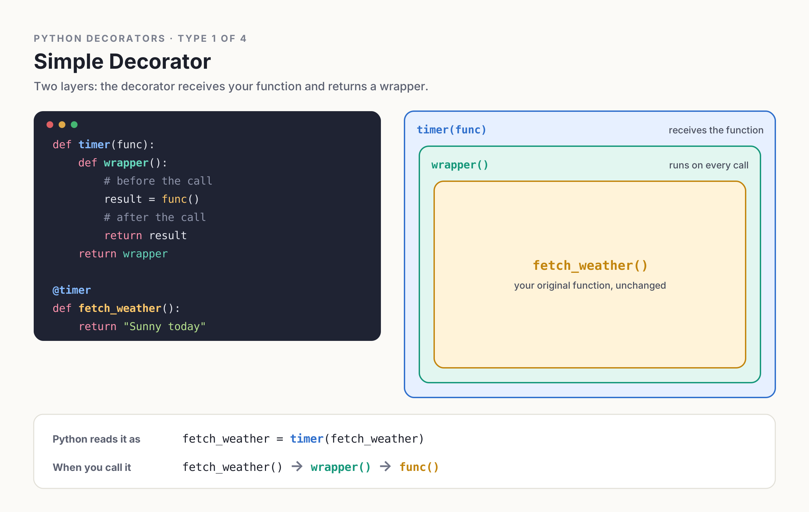
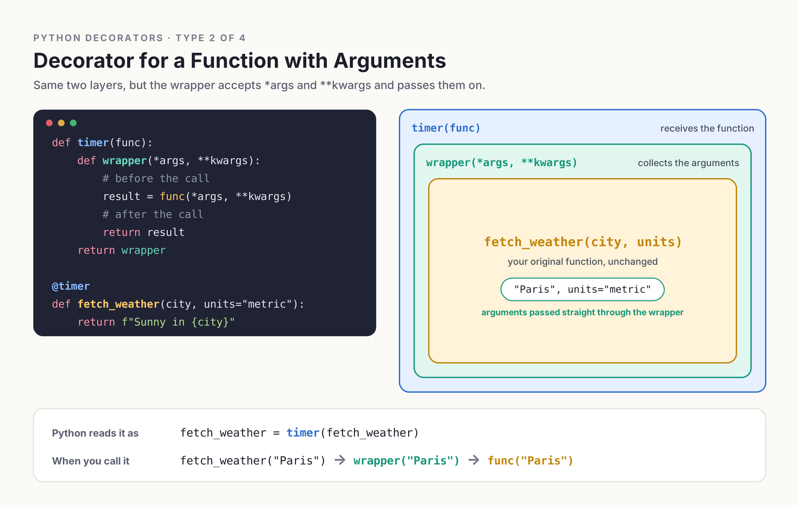
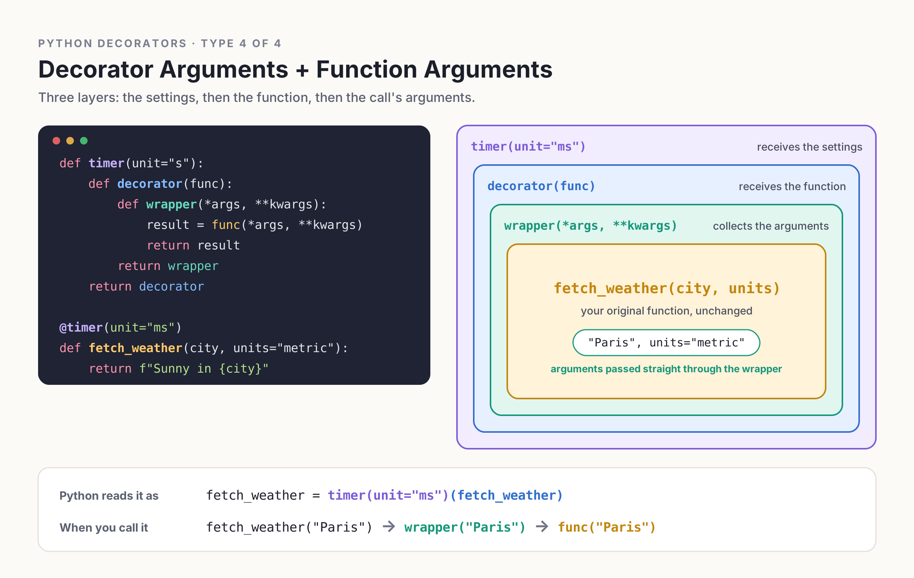

**Quick answer:** A Python decorator is a function that takes another function, wraps it with extra behavior, and returns the new version without changing the original code. Writing `@timer` above a function is shorthand for `func = timer(func)`. Decorators work because Python functions are first-class objects (they can be passed and returned like any value) and because inner functions form closures that remember the original function. A well-written decorator uses `*args` and `**kwargs` to accept any arguments, returns the wrapped function's result, and applies `@functools.wraps` to keep the original name and docstring. To pass settings, such as `@timer(unit="ms")`, you add an outer layer called a decorator factory. Multiple decorators stack bottom-up, so `@a` above `@b` means `a(b(func))`. Decorators can also be classes with a `__call__` method (useful for keeping state), can wrap methods and whole classes, need an `async` wrapper for async functions, and power built-ins like `@property`, `@staticmethod`, `@classmethod`, and `@functools.lru_cache`. This guide explains each concept with one running example: a slow weather-fetching function that we time, log, count, and cache.

If you've seen something like `@yo_i_am_decorating_this_func` above a Python function and wondered what's going on, you're in the right place. Python decorators look like magic at first, but they're built from a few simple ideas. In this guide we'll take **one small example** and grow it step by step until you understand every part of how decorators work.

## Our Running Example: A Slow Weather Fetcher

Here's the function we'll use for the whole post. It pretends to call a slow weather API:

```python
import time

def fetch_weather(city):
    time.sleep(0.5)  # pretend this is a slow network call
    return f"Sunny in {city}"
```

Our goal is to measure how long `fetch_weather` takes **without changing its code**. That's exactly what decorators are for.

## Step 1: Functions Are Objects in Python

In Python, functions are first-class objects. You can store them in variables and pass them to other functions, just like numbers or strings:

```python
get_forecast = fetch_weather       # no parentheses, so no call
print(get_forecast("Paris"))       # Sunny in Paris

def run(func, city):
    return func(city)

print(run(fetch_weather, "Tokyo")) # Sunny in Tokyo
```

**Since a function can receive another function, it can also add behavior around it. That's the core idea behind every decorator.**

## Step 2: Wrapping a Function with a Closure

Let's write a function that takes `fetch_weather`, wraps it with timing code, and returns the new version:

```python
def timer(func):
    def wrapper(city):
        start = time.perf_counter()
        result = func(city)
        print(f"{func.__name__} took {time.perf_counter() - start:.2f}s")
        return result
    return wrapper

fetch_weather = timer(fetch_weather)
fetch_weather("Paris")   # fetch_weather took 0.50s
```

Notice that `wrapper` uses `func` even after `timer` has finished running. That's called a **closure**: an inner function that remembers variables from the function that created it. Closures are what let decorators hold on to the original function.

## Step 3: The `@` Decorator Syntax



Writing `fetch_weather = timer(fetch_weather)` works, but Python gives us a cleaner shortcut:

```python
@timer
def fetch_weather(city):
    time.sleep(0.5)
    return f"Sunny in {city}"
```

`@timer` means exactly the same thing: "define this function, then pass it through `timer`." One thing to remember is that this happens **when the function is defined**, not when it's called.

## Step 4: Handling Any Arguments with `*args` and `**kwargs`



What if we add a `units` parameter to our fetcher? Our wrapper only accepts `city`, so it would break. The fix is to accept and pass along any arguments:

```python
def timer(func):
    def wrapper(*args, **kwargs):
        start = time.perf_counter()
        result = func(*args, **kwargs)
        print(f"{func.__name__} took {time.perf_counter() - start:.2f}s")
        return result
    return wrapper

@timer
def fetch_weather(city, units="metric"):
    time.sleep(0.5)
    return f"Sunny in {city} ({units})"
```

Now `timer` works on any function. Always remember the `return result` line, or your decorated function will quietly return `None`.

## Step 5: Keep Function Metadata with `functools.wraps`

There's a sneaky problem. Try this:

```python
print(fetch_weather.__name__)   # wrapper  (not what we want)
```

Our function lost its name and docstring, which makes debugging and documentation harder. The standard library fixes this with `functools.wraps`:

```python
import functools

def timer(func):
    @functools.wraps(func)
    def wrapper(*args, **kwargs):
        start = time.perf_counter()
        result = func(*args, **kwargs)
        print(f"{func.__name__} took {time.perf_counter() - start:.2f}s")
        return result
    return wrapper
```

Now `fetch_weather.__name__` is `fetch_weather` again. Make `@functools.wraps` a habit in every decorator you write.

## Step 6: Python Decorators with Arguments



What if we want to choose the time unit, like `@timer(unit="ms")`? Since `timer(unit="ms")` runs first, it must *return* a decorator. That means adding one more layer, often called a **decorator factory**:

```python
def timer(unit="s"):
    def decorator(func):
        @functools.wraps(func)
        def wrapper(*args, **kwargs):
            start = time.perf_counter()
            result = func(*args, **kwargs)
            elapsed = time.perf_counter() - start
            if unit == "ms":
                elapsed *= 1000
            print(f"{func.__name__} took {elapsed:.2f}{unit}")
            return result
        return wrapper
    return decorator

@timer(unit="ms")
def fetch_weather(city, units="metric"):
    time.sleep(0.5)
    return f"Sunny in {city} ({units})"

fetch_weather("Paris")   # fetch_weather took 500.12ms
```

Think of it as three layers: the outer one takes the settings, the middle one takes the function, and the inner one takes the call's arguments. Since `timer` is now a factory, you'll write `@timer()` with parentheses even when using the default unit.

## Step 7: Stacking Multiple Decorators

Let's add a second decorator that logs each call:

```python
def log_calls(func):
    @functools.wraps(func)
    def wrapper(*args, **kwargs):
        print(f"Calling {func.__name__}{args}")
        return func(*args, **kwargs)
    return wrapper

@log_calls
@timer(unit="ms")
def fetch_weather(city, units="metric"):
    time.sleep(0.5)
    return f"Sunny in {city} ({units})"
```

Decorators apply **bottom-up**, so this equals `log_calls(timer(unit="ms")(fetch_weather))`. When you call the function, the outermost one (`log_calls`) runs first. Picture layers of an onion: the call goes in through each layer, and the result comes back out. Order matters, so think about which behavior should happen first.

## Step 8: Class-Based Decorators for Keeping State

Any callable can be a decorator, including a class with a `__call__` method. This is handy when you want to keep state, like counting how many times we've fetched the weather:

```python
class CountCalls:
    def __init__(self, func):
        functools.update_wrapper(self, func)  # class version of @wraps
        self.func = func
        self.calls = 0

    def __call__(self, *args, **kwargs):
        self.calls += 1
        return self.func(*args, **kwargs)

@CountCalls
def fetch_weather(city):
    return f"Sunny in {city}"

fetch_weather("Paris")
fetch_weather("Rome")
print(fetch_weather.calls)   # 2
```

## Step 9: Decorating Methods and Classes

Our function-based `timer` works on methods too, because `self` simply arrives inside `*args`:

```python
class WeatherClient:
    @timer(unit="ms")
    def fetch(self, city):
        time.sleep(0.5)
        return f"Sunny in {city}"
```

Python also ships with built-in decorators you'll see all the time. `@property` makes a method behave like an attribute, `@staticmethod` and `@classmethod` change what the method receives, and `@functools.lru_cache` caches results, which is perfect for repeated weather lookups:

```python
@functools.lru_cache(maxsize=100)
def fetch_weather(city):
    time.sleep(0.5)
    return f"Sunny in {city}"
```

The second call for the same city returns instantly.

Decorators can even wrap **classes**. They receive the class instead of a function and usually return it after a small change:

```python
def add_source(cls):
    cls.source = "Demo Weather API"
    return cls

@add_source
class WeatherClient: ...

print(WeatherClient.source)   # Demo Weather API
```

## Step 10: Decorating Async Functions

If your weather fetcher is `async`, the wrapper must be `async` too and must `await` the original:

```python
import asyncio

def async_timer(func):
    @functools.wraps(func)
    async def wrapper(*args, **kwargs):
        start = time.perf_counter()
        result = await func(*args, **kwargs)
        print(f"{func.__name__} took {time.perf_counter() - start:.2f}s")
        return result
    return wrapper

@async_timer
async def fetch_weather(city):
    await asyncio.sleep(0.5)
    return f"Sunny in {city}"

asyncio.run(fetch_weather("Paris"))
```

## Common Decorator Mistakes to Avoid

Most decorator bugs come from a handful of slips: forgetting `return result` in the wrapper, forgetting `return wrapper` in the decorator, skipping `functools.wraps`, writing `@timer` when a factory needs `@timer()`, and putting work in the decorator body that should live inside the wrapper (it would run once at definition time instead of on every call).

## Wrapping Up

Here's the one idea to remember: `@decorator` above a function means `func = decorator(func)`, and `@decorator(args)` means `func = decorator(args)(func)`. Everything else builds on functions being objects and closures remembering their surroundings. Starting from a plain `fetch_weather`, we added timing, flexible arguments, preserved metadata, configurable units, logging, call counting, caching, and async support, all without touching the function's own code. That's the power of Python decorators.

## FAQ

### What is a decorator in Python?

A decorator is a function that takes another function and returns a new one with extra behavior, applied using the `@` syntax.

### Why use `functools.wraps` in a decorator?

It copies the original function's name, docstring, and other metadata onto the wrapper, so debugging and documentation still work correctly.

### How do I pass arguments to a Python decorator?

Add an outer function that accepts the arguments and returns the actual decorator, which is known as a decorator factory.